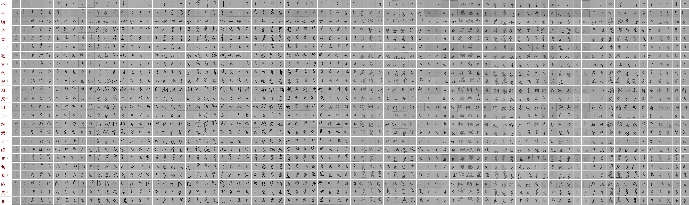

# PieceTrack

Reads handwritten piece-rate production records from a photograph and turns them into a payroll settlement, with a human checking the parts the model is unsure about.

The character recognition model is trained on handwriting I collected and labelled myself. On writers the model had never seen, it reads **93.1%** of Chinese characters and **86.7%** of Latin letters correctly. With a confidence threshold at 0.80 it passes about half the characters on its own and is wrong about one in 290 of them; the rest are flagged for a person to check.

---

## The problem

A relative runs a small sewing workshop. Every worker keeps a notebook and writes down what they made:

```
7.29号  黑色54套 + 咖色54套 + 灰色30套
7.30号  防潮垫 (80×1.9) 51个
8.01号  防尘罩 26个+26个+16个
```

At the end of the month the owner reads every notebook, adds it up by hand, and copies the totals into his own ledger. It takes a long time and it is easy to get wrong — and a mistake here is somebody's wages.

### Why a general OCR does not solve it

Reading the characters is the easy part. Knowing what they mean is not:

| What is written | What it means | What a general OCR returns |
| --- | --- | --- |
| `(80×1.9) 51个` | **51** items, sized 80cm × 1.9m. The `×` is a dimension, not multiplication | a row of numbers |
| `26个+26个+16个` | **68** items. Here the `+` really is addition | three separate numbers |
| `黑色54套 + 咖色54套` | **two** records, priced separately | one line of text |
| `防潮垫` + `套` vs `防潮垫` + `个` | ¥1.10 and ¥0.60 — **the rate depends on the item and unit together** | no pricing at all |

Both symbols appear in the same notebook, on the same page, meaning different things. That logic has to be written down as rules; no amount of recognition accuracy supplies it.

---

## Collecting the data

There is no public dataset of this handwriting, so I made one: **6,174 labelled character samples from 19 writers**.

The samples were written into a printed A4 template where **every cell carries a small grey label telling the writer which character to write**. Because the template fixes what belongs in each cell, locating the cell is enough to know the label — **nothing was annotated by hand afterwards**. Collecting the same volume as free handwriting would have meant tens of hours of labelling.

| | |
| --- | --- |
| Samples | 6,174 |
| Classes | 88 — 24 Chinese characters, 2 symbols (`×` `+`), 10 digits, 52 Latin letters |
| Writers | 19 (16 wrote the Chinese page, 11 the English page) |
| Per Chinese character | 82 samples |
| Per Latin letter | 61–62 samples |
| Photographs | 125, taken on phone cameras under ordinary room lighting |

Writers were asked to use their normal hand, not to write neatly. Pens range from hard pencil to thick marker; one sheet changes pen halfway through. That unevenness is the point.



### Two ways of finding the cells

Half the sheets came back printed from an earlier version of the template, so there are two extraction paths:

**`warp_cells.py` — sheets with corner markers.** Four black squares give four known points, which is enough for a homography that removes perspective and scale in one step. The cell coordinates are not inferred from the image at all: `build_model.js` renders the template in a headless browser and reads each cell's geometry from the page itself, so the grid is exact.

**`grid_cells.py` — sheets without them.** Morphological opening keeps only strokes that run a long way horizontally or vertically, which discards the handwriting and leaves the printed rules. A cell's side borders run exactly as far as the cell is tall, so projecting the vertical rules onto the y axis gives a square wave whose peaks *are* the rows; the horizontal rules do the same for columns. Rows are measured inside the first two columns only — a row of two cells carries a fifth of the signal of a row of ten and vanishes under any threshold that suits the others.

All 125 photographs were extracted successfully.

---

## Checking the data before training it

Automatic cell extraction fails quietly. It does not raise an error — it hands you a crop labelled with the wrong character, and the model dutifully learns the wrong thing.

Two tools run over every new batch:

- **`contact_sheet.py`** lays every sample of a class in one row. A whole sheet shifted out of alignment is obvious at a glance.
- **`outliers.py`** scores each crop by its distance from its class's median image. A crop holding the wrong character ranks far above the rest.

They caught four real faults:

1. **An entire sheet labelled two cells to the left.** The column rebuilder assumed the first column it detected was column 0; on one photograph the leftmost two columns went undetected and the whole lattice slid over. Cells labelled 个 held 张, cells labelled 灰 held 绿. Nothing errored. Fixed by anchoring the grid on the measured extent of the printed rules instead of counting from the first column found.
2. **Characters clipped on page 2.** The crop margin was taken as a fraction of cell *height*; page 2 uses shorter cells, so a tenth of their height removed every descender. Now taken from cell width, which is near enough equal on both pages.
3. **A writer who lost their place.** Highest outlier at z = 5.2: a cell labelled `i` holding a correction written over a mistake, and the cell before it holding two letters. Both excluded, with the reason recorded in `exclude.txt`.
4. **Corner markers missed on five photographs.** Under certain lighting the threshold filled whole printed cells, and a cell is twice the size of a marker, so the size filter calibrated itself on cells and discarded the real markers. Separated by what is *inside* them — ink versus paper — measured against each sheet's own paper brightness.

Three of the four were heuristics tuned on one batch that broke on the next. Every new batch now re-runs the checks, and every change to the detection logic re-runs the old batch as a regression test.

---

## Evaluation

**The train/test split holds out whole writers.** Two cells of the same character on the same sheet are nearly the same image; a random split puts one in training and the other in test, and reports an accuracy that measures only whether the model memorised this handwriting. What the system actually has to do is read a worker it has never seen.

| | Train | Validation | Test |
| --- | --- | --- | --- |
| Chinese (36 classes) | 11 writers / 2,016 | 2 writers / 432 | **3 writers / 504** |
| Latin (52 classes) | 8 writers / 2,286 | 1 writer / 416 | **2 writers / 520** |

Test writers were chosen to span both template versions and both collection rounds, so the score is not flattered by all of them happening to be the same batch of paper.

| Model | Validation | Test (unseen writers) |
| --- | --- | --- |
| Chinese, 36 classes | 99.8% | **93.1%** |
| Latin, 52 classes | 93.3% | **86.7%** |
| Latin, case-insensitive | — | **88.8%** |

The gap between 99.8% and 93.1% is the cost of meeting a new hand. Both sets are unseen data; the only difference is that the test set contains unseen *people*. A random split would have reported the first number.

Per-writer, Chinese: 91.7% / 95.8% / 92.4%. Reported separately because a single average hides the case this system fails in — one worker the model cannot read, whose pay is then wrong every month.

### Augmentation: the setting that looked obviously right was wrong

| Augmentation | seed 0 | seed 1 | seed 2 | mean |
| --- | --- | --- | --- | --- |
| Strong | 87.1% | 88.1% | 87.5% | **87.6%** |
| None | 90.9% | 92.5% | 92.9% | **92.1%** |
| Mild | 93.1% | — | — | **93.1%** (one seed) |

My first augmentation settings cost 4.5 points. Three seeds, ranges that do not overlap, paired t-test p ≈ 0.01.

The diagnosis came from measuring the data: upper-case letters in this collection are **1.4%** taller than lower-case, while the scale jitter spanned ±15% — an order of magnitude larger than the signal it was burying. Morphological dilation up to a 5×5 kernel on a 64×64 image had the same effect on thin strokes. Dialled back inside the range a different hand would actually produce, augmentation helps again.

On the Latin task the same change was worth 9.2 points (77.5% → 86.7%).

### From accuracy to a product decision

Per-character accuracy is the wrong number to ship on. A record is six or so characters and every one must be right: at 93.1% per character, about 65% of records would be fully correct. So the question is not how often the model is right, but **whether it knows when it is not**.

Measured on the 504 held-out characters:

| Confidence threshold | Characters passed without review | Accuracy of those | Errors let through |
| --- | --- | --- | --- |
| none | 100% | 93.1% | 35 |
| 0.70 | 68.3% | 99.4% | 2 |
| **0.80** | **56.2%** | **99.7%** | **1** |
| 0.90 | 36.9% | 100.0% | 0 |

At 0.80 the amount of checking a person has to do halves, and roughly one error in 290 gets past. Zero errors above 0.90 is measured on 168 characters, which supports an error rate below about 2% — not a claim of zero.

This settles the interface: not *which rows can be skipped* — requiring all six characters of a row to clear 0.80 would still send 97% of rows to a person — but **which characters within each row need a second look**. The reviewer sees the whole row with two or three characters highlighted.

---

## Current status

**Working:**
- Both extraction pipelines, on all 125 sheets
- Both trained models, reproducible from the committed checkpoints
- The evaluation and quality-control tooling
- The web interface: settings, scanning, review, settlement history, CSV export, responsive layout

**Not done:**
- **The web interface runs on mock data.** The models are not yet served to it. Everything the review screen displays is seed data shaped like what the model will produce.
- **Segmentation of real notebook pages is untested.** The 93.1% is measured on isolated cells cut from a printed grid. Real pages have no grid, uneven line spacing and characters that touch. This is the largest unknown in the project and it sits at the front of the pipeline.
- The rules for `×`, `+` and multi-item lines are specified and shown in the interface, but not yet implemented as code.
- Case cannot be recovered from isolated cells, because writers fill the box whatever the case. It needs line context.

---

## Why train a model instead of calling a cloud API

For a product shipping tomorrow, benchmarking against a hosted document-understanding API would be the right first move, and using it if it won. Two reasons this one is trained here anyway: the character set is closed at 36 classes, so a small model runs offline on cheap hardware in a workshop with poor connectivity; and building the pipeline end to end — collection, labelling, training, evaluation — was the point.

The parts that would not change either way are the rules layer and the review workflow. Those have to be built regardless of what reads the characters.

---

## Layout

```
recognition/          Python: extraction, training, evaluation, QC
  warp_cells.py       sheets with corner markers -> homography -> crops
  grid_cells.py       sheets without -> morphology + projection -> crops
  build_model.js      measures cell geometry from the rendered template
  dataset.py          writer-grouped splits, preprocessing, augmentation
  train.py            training and per-writer evaluation
  coverage.py         confidence threshold vs. review workload
  contact_sheet.py    QC: every sample of a class in one row
  outliers.py         QC: crops far from their class median
  models/             trained checkpoints and the result of every run
web/                  React + TypeScript interface (currently mock data)
template/             the A4 collection template
qa/                   contact sheets for the collected data
```

## Running it

```bash
python -m venv .venv && . .venv/bin/activate     # Windows: .venv\Scripts\activate
pip install -r recognition/requirements.txt

# reproduce the reported numbers (needs the dataset, see below)
cd recognition
python coverage.py models/zh_mild.pt

# retrain
python train.py --task zh --epochs 60 --mild --out models/zh.pt
```

The 6,174 crops are not committed — they are 56MB of small images that nobody reads in a browser. They are available from the dataset-v1 release; unpack them to recognition/crops/; unpack them to `recognition/crops/`. The contact sheets in `qa/` show the whole dataset at a glance.

## Privacy

Real notebooks carry workers' names and wages. Nothing identifying a real person appears in this repository: the interface uses invented names, and the collected handwriting is anonymous character samples contributed by volunteers.
